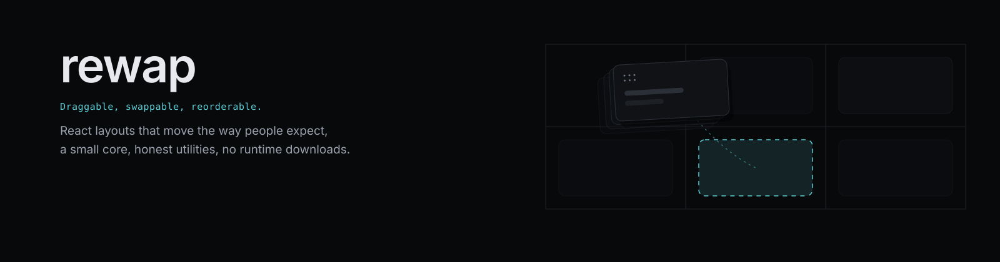

<p align="center">
  
  <h1 align="center">rewap</h1>
</p>

A React library for dragging, swapping, reordering and arranging items.

[](https://github.com/nashiuso/rewap/actions/workflows/ci.yml)
[](./LICENSE)

**1.1.1 alpha — unreleased.** Distributed from GitHub; not published to the npm registry.

<p align="center">
  <a href="https://nashiuso.github.io/rewap/"></a>&nbsp;
  <a href="https://nashiuso.github.io/rewap/playground/"></a>&nbsp;
  <a href="https://github.com/nashiuso/rewap"></a>
</p>

## Installation

Install from GitHub with npm:

```bash
npm install github:nashiuso/rewap
```

For a reproducible install, append `#` and a full commit SHA or an existing tag
to the GitHub specifier (for example, `github:nashiuso/rewap#<ref>`). Replace
`<ref>` with a commit or tag that exists in the repository; npm records it in the lockfile.

Git installs run the package's `prepare` script to build the distribution files.
React 18 or newer is required.

## Quick example

```tsx
import { Item, Layout } from "@nashiuso/rewap";
import "@nashiuso/rewap/styles.css";

export function App() {
  return (
    <Layout mode="swap">
      <Item id="one">One</Item>
      <Item id="two">Two</Item>
    </Layout>
  );
}
```

Items can be dragged with a pointer, touch, or keyboard. `Layout` also accepts an
`onChange` callback for controlled order and a `motion` preset.

## Layout modes

- `swap` exchanges the dragged item with its target.
- `reorder` inserts the item at its target and shifts the items in between.
- `grid` places the item by grid cell. Use `columns`, `minColumnWidth`, or
  `Item`'s `columnSpan` and `rowSpan` to shape the grid.

## Documentation

The Fumadocs site covers installation, the API, motion, accessibility, SSR and
known limitations: [rewap docs](https://nashiuso.github.io/rewap/).

## Playground

Try the modes and motion presets with six local draggable items:
[open the playground](https://nashiuso.github.io/rewap/playground/).

## Development and tests

```bash
npm ci
npm run format:check
npm run typecheck
npm run lint
npm test
npm run build
npm run test:types
npm run test:e2e
npm run docs:build
npm run examples:build
npm run site:build
npm run verify:github-install
```

Playwright needs Chromium once per machine: `npx playwright install chromium`.
`npm run site:build` writes the documentation and playground to `site-dist/`.

## License

[MIT](./LICENSE) © [nashiuso](https://github.com/nashiuso)
